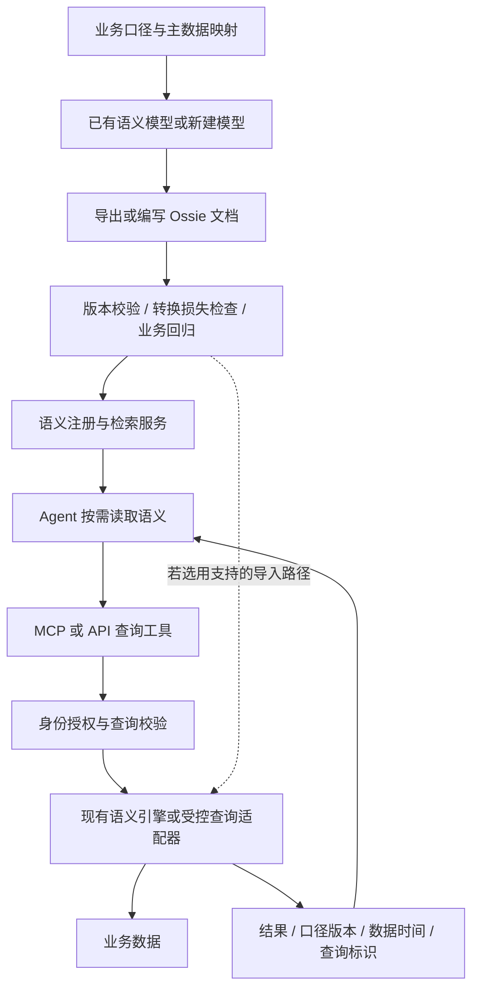

# Agent 消费数据：Apache Ossie / OSI 应该放在哪里

核查日期：2026-11-12。本文讨论 **Apache Ossie（incubating）**，原名 **Open Semantic Interchange（OSI）**；不是网络七层模型中的 OSI。名称与沿革见 [官方站点](https://ossie.apache.org/)。

本文以 Agent 数据消费作为主场景。架构与工具名为本仓库设计；没有声明各厂商或 DeepAnalyze 已实现这些接口。

## 1. 要交付的是 Agent 可以理解和调用的数据服务

以终端业务的问题为例：“九月 East 区域各机型净销售额是多少？哪些机型下降了？”

Agent 要完成的工作可以拆成：

1. 找到与问题有关的已授权数据产品。
2. 理解“净销售额”、区域、机型、销售时间的含义。
3. 确认退款、时间、币种及历史归属规则；存在歧义时澄清。
4. 发起查询，拿到受授权约束的结果。
5. 判断结果是否足够，必要时再查比较期间。
6. 分析并回答，附上数据时间、口径和来源。

这里至少需要 **语义发现、查询执行、结果证据** 三类能力。自然语言到 SQL 只覆盖其中一段。

## 2. Ossie 管业务定义，运行服务负责兑现定义

Ossie 使用 JSON / YAML 表达可交换的语义模型。核心规范包含数据集、字段、关系、指标和 `ai_context` 等结构。它可以让本来存于不同工具中的业务定义进入共同表示。[核心规范](https://github.com/apache/ossie/blob/e6ad94ee87a53fd8f8b6dbf0de33fab59e406c0c/core-spec/spec.md)

建议的分工如下：

| 部分 | 负责什么 | 不应据此推定 |
| --- | --- | --- |
| Ossie 语义文档 | 描述并交换概念、来源映射、指标表达式、关系、AI 上下文 | 文档存在就有在线查询服务 |
| 语义目录 / 注册服务 | 管版本、负责人、检索与授权可见性 | 只需把全公司 YAML 塞进提示词 |
| MCP / API | 让 Agent 发现和调用工具、获取上下文 | 工具协议自动理解净销售额口径 |
| 语义引擎 / 查询适配器 | 验证请求、规划和计算指标 | 任何支持 SQL 的数据库都懂语义指标 |
| 身份与授权服务 | 确认用户、限制数据行和工具范围 | `ai_context` 中写权限说明就会强制生效 |
| 分析 Agent | 选择任务、组织查询、分析结果 | 模型自行改公式仍然算使用了统一口径 |

MCP 官方定义工具、资源等上下文与调用机制；它不决定业务应用如何理解和使用上下文。[MCP 架构](https://modelcontextprotocol.io/docs/learn/architecture)

更准确的关系是：**Ossie 提供可共享的定义；MCP / API 运送发现和调用请求；实现语义的服务计算并授权；Agent 使用结果。**

## 3. 数据供给侧与 Agent 运行时分开建设



这有两种现实路径：

- **已有语义平台。** 平台保留权威计算；通过导出 / 适配将模型转换为共享语义表示，Agent 检索后调用该平台。需要核实导出是否保留所有重要规则。
- **没有统一模型。** IT 与业务先定义对象、指标和映射，再用 Ossie 表达；另外选择或开发执行实现。手写 JSON 本身不能替代计算、权限和运维。

应确定一个权威维护入口，避免平台模型和 Ossie 文件各自修改后不一致。可选择单向发布，或在具备无损能力时实现受控双向同步。

## 4. Agent 一次请求如何运行

以下工具是建议接口，不是 Ossie 或 MCP 规定的标准业务方法：

| 步骤 | 工具示意 | 输入和输出 |
| --- | --- | --- |
| 找语义 | `search_semantics` | 业务问题 → 当前身份可见的模型和指标候选 |
| 读定义 | `get_semantics` | 模型 ID / 版本 → 指标、维度、关系、来源与使用限制 |
| 查数据 | `query_metrics` | 指标 ID、维度、过滤和时间范围 → 授权结果与证据 |
| 看实体 | `get_entity` | 设备或门店 ID → 授权属性与关联；需另外实现对象访问 |

用户的问题首先映射到 `terminal_sales.sales.net_sales`。Agent 读取定义，知道它使用销售日期归属、会回溯扣减退款，不等于财务收入。若“下降”没有比较基准，Agent 应说明采用环比或先澄清；不能只有九月数据就声称下降。

示意查询：

```json
{
  "model": "terminal_sales",
  "semantic_revision": "sales-contract-v1",
  "metric": "sales.net_sales",
  "group_by": ["sales.model_name"],
  "filters": [{"field": "sales.region", "op": "eq", "value": "East"}],
  "time": {
    "field": "sales.sale_date",
    "start": "2026-09-01",
    "end_exclusive": "2026-10-01"
  }
}
```

运行服务从可信会话获取身份，校验模型版本、字段、合法组合与数据范围，然后调用已有引擎。不可让模型传入的 `region=East` 充当授权证明。

返回结果除数值外，应包含 `query_id`、`semantic_revision`、`data_as_of`、适用范围和警告。**这些是本仓库建议的响应设计，并非已确认的 Ossie 标准响应格式。**

现有虚构样例只包含九月销售，可返回 East 的 Model-A 170 元、Model-B 300 元；缺少八月基准，不能输出环比结论。

## 5. 一份真正按规范编写的语义文档

仓库新增 [terminal-sales.ossie.json](../examples/terminal-sales/terminal-sales.ossie.json)，对应 [现有 SQLite 示例](../examples/terminal-sales/README.md) 的 `mart_sale_line`。它包括：

- 模型名、说明和 AI 使用上下文。
- 数据集及订单行主键。
- 销售日期、区域、机型和净额字段。
- 以 `SUM(net_amount_cents) / 100.0` 定义的净销售额指标。

示例固定采用上游提交 `e6ad94ee87a53fd8f8b6dbf0de33fab59e406c0c` 的 **0.3.0.dev0 开发草案**，用于展示格式并进行 JSON Schema 结构校验，不建议直接依赖该草案投产。它不是对厂商已有 OSI 0.1.1 接口的兼容声明。

三个版本概念必须分开：

| 概念 | 示例 | 含义 |
| --- | --- | --- |
| 标准格式版本 | `0.3.0.dev0` | 文件使用哪一版语法 |
| 企业业务定义版本 | `sales-contract-v1` | 指标的业务规则版本，由部署系统管理 |
| 数据截止时间 | `2026-10-31` | 本次可见事实的截止时间 |

JSON Schema 校验仅证明结构符合固定草案。它不能证明数据存在、源字段正确、SQL 在目标引擎可执行、权限满足要求或厂商无损导入。

文档中的 `ai_context` 帮助模型理解和澄清；真正的状态过滤、退款处理仍在准备层与执行层实现。描述不能代替执行。

## 6. Ossie 不只在讨论元数据，但要区分成熟度

截至核查日，Apache 官网 [Downloads](https://ossie.apache.org/downloads/) 显示尚无发布版。核心文档记录的历史 OSI 0.1.1 与厂商对此格式的支持，不能等同于已有 Apache 正式发布包。

当前核心规范明确标记 `0.3.0.dev0` 为未发布开发版本，且存在破坏性变更。例如新草案使用根级单模型，旧格式使用 `semantic_model` 数组；`custom_extensions` 改为 `nonportable_extensions`。[版本历史](https://github.com/apache/ossie/blob/e6ad94ee87a53fd8f8b6dbf0de33fab59e406c0c/core-spec/spec.md)

此外，上游正在编写：

- **Relational Query Interface 草案**：定义关系与 measure 查询语义，以 `AGG()` 等机制让引擎负责指标求值和关联后计数正确性。语法仍是草案，不能放到普通数据库就假设可运行。[查询接口草案](https://github.com/apache/ossie/blob/e6ad94ee87a53fd8f8b6dbf0de33fab59e406c0c/core-spec/relational_semantics.md)
- **Ontology 规范**：表达概念、关系、规则及映射，更接近“设备是什么、与工单是什么关系”这一层。当前文档同属开发版本；它不意味着已经提供业务操作执行系统。[Ontology 规范](https://github.com/apache/ossie/blob/e6ad94ee87a53fd8f8b6dbf0de33fab59e406c0c/ontology/ontology.md)

因此，不宜断言 Ossie 永远只是一个指标文件格式；也不宜把研发中的查询与本体设计当成所有厂商现成支持的能力。

## 7. 实际互操作比“支持 OSI”四个字更具体

一个可核查的例子是 Actian AI Analyst：其文档声明面向 OSI 0.1.1，支持导入导出，但导出不保留模型过滤、粒度和主键等若干信息，也不会导出完整 AI Analyst 对象。其 Lossless 格式另行承担完整备份。[官方导出说明](https://docs.actian.com/ai-analyst/governance/export-semantic-layer-and-agents/open-semantic-interchange-format.html)

这不表示所有转换器有同样局限，而是说明应逐项验证：

1. 支持哪个标准版本，是导入、导出还是双向？
2. 公式、关联、主键、日期和业务说明是否保留？
3. 权限和过滤在哪里执行？转换失败是否显式报告？
4. 厂商扩展能否被目标识别；无法识别时是否拒绝关键功能？
5. 相同数据、身份与问题在转换前后是否结果一致？

官方有独立的 [转换器仓库](https://github.com/apache/ossie-converters)。成员名单、仓库存在或字段能解析，都不能替代上述验收。

## 8. 对终端 IT 的首期建设建议

优先建设一个 **Agent 数据服务**，把 Ossie 作为可交换的语义资产格式来验证：

| 工作 | 交付物 |
| --- | --- |
| 选定 20 个真实问题 | 能回答、应澄清、缺数据三类问题集 |
| 定义一个领域的数据产品 | 对象、指标、时间规则、字段映射与负责人 |
| 建立权威计算路径 | 现有语义引擎或受控数据服务 |
| 编写 / 导出语义 | 固定版本文件与转换损失说明 |
| 建发现与查询接口 | 授权可见的目录及查询工具 |
| 为结果补充证据 | 查询标识、定义版本、截止时间与数据范围 |
| 比较 Agent 行为 | 原始表直查、语义辅助 SQL、受控指标调用三组结果 |

把常见指标查询与开放探索分开提供。核心经营指标使用固定计算入口；专项分析可以对授权结果集或只读沙箱做更自由的计算。自由计算得到的派生指标应明确标注，不应自动变成权威口径。

若用 DeepAnalyze，它需要实际的工具 / 执行适配；不能因为具备 Python 执行能力就认定已经原生消费 Ossie。EvoOntology 可以帮助维护语义上下文，但同样需要映射到企业权威定义与受控执行服务。

首期验收应展示：Agent 找对指标、遇到歧义能澄清、查询不越权、没有基准数据时不会编造下降结论、每个数字可追溯。Ossie 的收益则通过“换一个消费方或引擎，需要重写多少业务定义、转换后丢了什么、结果是否一致”来衡量。
