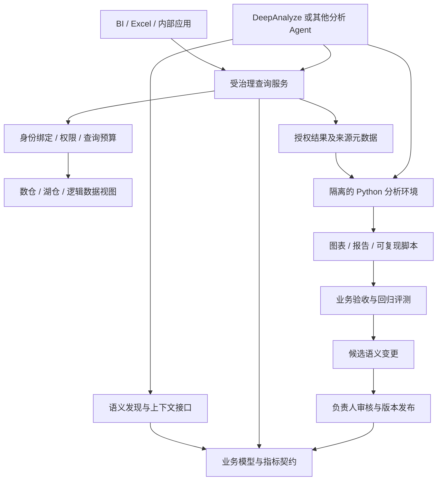

# 企业参考架构与选型

以下是基于 [厂商调研](vendor-landscape.md) 与 [DeepAnalyze 调研](deepanalyze.md) 提出的架构建议，不是已经实现或测试的系统。

## 1. 建设目标与责任分层

企业可以共用一套业务定义，同时按领域拆分模型和责任。统一客户标识、日期规则和关键指标，并不要求销售、财务、供应链共享一个巨大模型。



图中的 Agent 适配、身份传递、结果元数据和反馈流程需要实际实现。选用任何单个厂商都不能省略这些边界的验证。

## 2. 三种可渐进建设的形态

| 形态 | 建设内容 | 适用阶段 | 主要局限 |
| --- | --- | --- | --- |
| 可信指标服务 | 固定核心指标、维度、时间及权限 | 先解决报表口径冲突 | 开放式分析范围有限 |
| 指标服务 + 分析 Agent | 模型调用指标与隔离分析工具 | 问数、归因探索、报告 | 需要评测解释与后处理 |
| 对象与动作闭环 | 业务实体状态、受控写回、审计 | 运营 Agent 与人协作 | 系统整合与操作治理更复杂 |

从第一种起步通常更容易定义验收标准，但如果主要矛盾是分散系统中的业务对象访问，应先补齐跨源映射；如果主要矛盾是运营执行，则需要同时规划动作接口。

## 3. 先定义指标契约

以“净收入”为例，契约至少包含：

| 字段 | 应说明的内容 |
| --- | --- |
| 稳定标识和名称 | `finance.net_revenue`；与销售额、回款额区分 |
| 业务负责人 | 谁确认定义、谁批准变更 |
| 公式和状态范围 | 是否扣折扣、退款、税；排除哪些订单 |
| 粒度与主键 | 订单、订单行或财务分录 |
| 时间依据 | 确认收入日、退款发生日；时区和财年 |
| 维度及关联 | 客户、地区、商品；哪些组合有效 |
| 聚合规则 | 可加、半可加、比率、去重 |
| 历史处理 | 迟到数据、重述和缓慢变化维度 |
| 权限与数据范围 | 用户、组织、字段和数据行 |
| 版本与新鲜度 | 定义版本、数据截止时间、刷新要求 |
| 证据与回归 | 来源表、参考 SQL、小样本预期值 |

合同不应只写在文档中。能够由引擎执行的规则进入模型，无法自动判断的业务含义保留负责人和审核记录。

## 4. Agent 接口应传递哪些信息

建议将语义发现与查询分开：发现阶段只检索本次任务需要的概念；查询阶段由服务器校验指标、维度和权限。以下为本仓库设计的接口示意，不是任一厂商原生 API：

```json
{
  "metric": "finance.net_revenue",
  "dimensions": ["customer.region", "calendar.month"],
  "filters": [{"field": "customer.segment", "op": "eq", "value": "enterprise"}],
  "time_range": {"start": "2026-07-01", "end_exclusive": "2026-10-01"},
  "semantic_version": "finance-2026-11-01"
}
```

用户身份应由服务端会话绑定，不接受模型自行提交的身份作为授权依据。返回结果应携带查询 ID、定义版本、数据时间、过滤说明和来源引用，便于后续图表及报告引用。

授权后的结果仍有使用边界。例如只能看部分客户的销售人员，其汇总只能解释为授权范围合计。模型生成的报告不能把它改称全公司收入。

## 5. 自动语义建设的合理边界

| 自动发现的内容 | 可形成的成果 | 发布前检查 |
| --- | --- | --- |
| 字段类型、空值、候选主键 | 数据剖析结果 | 全量或代表性样本验证 |
| 常见 SQL 与关联模式 | 候选指标、关联关系 | 基数、粒度和业务确认 |
| 同义词和用户问题 | 术语映射建议 | 歧义、适用领域 |
| 成功执行轨迹 | 查询示例与来源证据 | 不能以执行成功代替口径正确 |
| 多次失败的分析 | 模型、工具或文档修订候选 | 同一问题集的回归评测 |

EvoOntology 提供了基于轨迹演进的参考，但自动演进不应默默覆盖已批准的财务口径。保留父版本、候选变更、负责人、回归结果和回滚点。

## 6. 按主要矛盾选候选方案

| 主要矛盾 | 优先验证 | 验证问题 |
| --- | --- | --- |
| Power BI 中重复定义指标 | 共享语义模型 / Fabric | 报表能否复用计算而不复制公式？ |
| 自助分析长期依赖分析师 | Looker | 常见分析路径是否可建模且不重复计数？ |
| dbt 工程成熟，多工具口径分裂 | dbt Semantic Layer | 主要消费者能否真正使用同一指标？ |
| 自研应用和 BI 都要数据接口 | Cube | 权限、延迟、并发和新鲜度能否同时满足？ |
| 多 BI、Excel 与大规模分析 | AtScale | 层级和聚合兼容性、真实负载收益如何？ |
| Snowflake 是主要底座 | Semantic Views | SQL 与 AI 的实际执行路径能否保持一致？ |
| Databricks 是主要底座 | Metric Views | 实际版本和外部工具是否支持所需语义？ |
| 数据分散，先统一访问 | Denodo | 跨源性能、实体映射和源故障影响如何？ |
| 自建自然语言问数 | SuperSonic 类架构 | 映射、校正、SQL 翻译能否独立诊断？ |
| 数据分析和报告自动化 | DeepAnalyze 类模型 | 在统一工具与预算下是否有实际收益？ |
| Agent 重复探索业务语义 | EvoOntology 类知识层 | 证据、演进、版本与审批如何衔接？ |
| Agent 需要执行运营动作 | Palantir 式对象与动作架构 | 事务、授权、状态同步和恢复如何实现？ |

这张表用于缩小验证范围，不是性能或成熟度排名。商业版、自托管、社区版的能力、许可和服务条件不能互相替代。

## 7. 建议的职责分工

业务负责人确认口径和适用范围；分析工程师实现指标与实体模型；平台团队负责权限、性能和运行；AI 团队负责工具适配与任务评测。变更进入共同的版本流程。

衡量治理效果的指标应包括：重复口径减少、跨工具结果一致、业务问题覆盖、问题定位时间和变更回归通过率，而不仅是模型数量或接入数据表数量。
