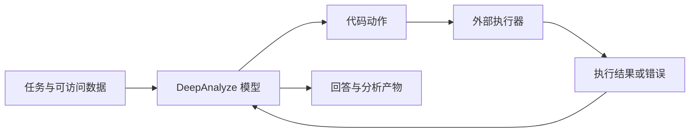

# DeepAnalyze：模型、分析系统与企业语义层的关系

资料核查日期：2026-11-12。本文讨论 RUC-DataLab 的自主数据科学项目，与同名的崩溃定位研究无关。完成了官方资料阅读与部分源码静态核查；未下载权重、启动推理服务或复现论文成绩。

## 1. 谁做的，具体交付了什么

DeepAnalyze 最初由中国人民大学、清华大学相关研究人员公开，提供面向数据科学的模型及配套代码。研究对象是从数据发现、处理、分析到报告生成的多步骤任务。[项目主页](https://ruc-deepanalyze.github.io/)

需要区分四项交付物：

| 交付物 | 用途 | 证据 |
| --- | --- | --- |
| DeepAnalyze-8B | 生成分析动作和代码的模型权重 | [模型卡](https://huggingface.co/RUC-DataLab/DeepAnalyze-8B) |
| DataScience-Instruct-500K | 训练数据发布入口 | [数据卡](https://huggingface.co/datasets/RUC-DataLab/DataScience-Instruct-500K) |
| 推理与训练代码 | 运行动作循环，训练模型 | [固定版本仓库](https://github.com/ruc-datalab/DeepAnalyze/tree/afc697a11675c59683b9f6596c3ab3b3d661182a) |
| DA-Studio / Chat UI | 文件、会话、执行与报告的使用界面 | [固定版本说明](https://github.com/ruc-datalab/DeepAnalyze/blob/afc697a11675c59683b9f6596c3ab3b3d661182a/demo/chat_v2/README.md) |

模型卡和数据卡的许可证字段均标为 MIT；代码仓库也提供 MIT 许可证。这些是各发布件的声明，使用衍生数据时仍应查看具体材料的来源和条款。本仓库不重新分发权重或数据。

原始论文 v1 与 2026 年 PMLR 会议页面存在作者列表、基准数量等差异。下文涉及具体分数时固定引用 **2025 年 arXiv v1**；PMLR 页面仅作为后续发表记录，不混用实验结果。[原始论文](https://arxiv.org/abs/2510.16872v1)、[PMLR 记录](https://proceedings.mlr.press/v306/zhang26aq.html)

## 2. 它要服务什么场景

典型任务不是一次性回答某个数字，而是：读取多个文件，判断相关数据，清洗并对齐，计算统计量或建立模型，生成图表，再给出报告。官方模型卡列出的数据类型包括表格、数据库及部分半结构化、文本材料。[模型卡](https://huggingface.co/RUC-DataLab/DeepAnalyze-8B)

从企业使用角度，可以分成三类候选任务：

| 任务 | 可能有价值的能力 | 企业仍需提供 |
| --- | --- | --- |
| 多文件专项分析 | 主动探索、清洗、整合、绘图 | 文件权限、口径、数据来源 |
| 指标变化解释 | 反复分组比较，寻找变化贡献 | 权威指标接口和统计边界 |
| 建模与研究报告 | 多轮编程、执行反馈、报告组织 | 验证集、评价方法、执行资源 |

以上是本仓库的适用性分析，不代表已在企业数据上验证。固定口径的高频指标查询未必需要长链条 Agent；可先由语义服务直接返回结果，把模型用于解释或后续分析。

## 3. 模型设计：把数据分析动作纳入训练与推理

官方开发说明以 **DeepSeek-R1-0528-Qwen3-8B** 为基座，增加数据分析动作标记。它不是从零训练的通用基础模型，也不能仅凭“8B”推断能力与硬件成本。[固定版本开发说明](https://github.com/ruc-datalab/DeepAnalyze/blob/afc697a11675c59683b9f6596c3ab3b3d661182a/README.md)

词表扩展代码列出五组标记：[add_vocab.py](https://github.com/ruc-datalab/DeepAnalyze/blob/afc697a11675c59683b9f6596c3ab3b3d661182a/deepanalyze/add_vocab.py)

| 标记 | 在运行协议中的作用 |
| --- | --- |
| `Analyze` | 规划、推理和反思等文本 |
| `Understand` | 表达对数据内容和结构的理解 |
| `Code` | 待执行的 Python 代码 |
| `Execute` | 执行器返回的结果或错误 |
| `Answer` | 最终回答 |

基础运行器将代码执行结果加入下一轮对话，而不是要求模型在一次生成中完成全部工作。模型决定后续动作，但调用模型、执行代码和收集输出仍由外部程序承担。

这张图是根据运行器绘制的简化示意。基础代码默认最多 30 轮；请求在 `</Code>` 处停止后提取代码，执行后把反馈加入消息，检测到 `Answer` 时结束。[运行器](https://github.com/ruc-datalab/DeepAnalyze/blob/afc697a11675c59683b9f6596c3ab3b3d661182a/deepanalyze.py)

**设计含义。** 对大表，实际读取、聚合与绘图可在执行环境完成，模型主要处理必要的结果和反馈。这不能消除内存、I/O 或上下文限制，但避免要求模型一次读入全部表格文本。将流程选择交给模型，也不意味着可以省略超时、轮数和权限边界。

## 4. 训练路线：先单项能力，再多步骤协作

论文将方法概括为课程式训练与基于数据的轨迹合成，强化学习使用 GRPO，并结合规则及模型评价。其目的在于让模型先具备单项能力，再学习多轮交互。[论文第 3 节](https://arxiv.org/html/2510.16872v1)

公开训练脚本提供更具体、可检查的工程证据：

| 阶段 | 脚本观察 | 设计分析 |
| --- | --- | --- |
| 单能力 SFT | 表格、结构化知识、文件、代码及通用推理数据；`max_length=8192` | 为数据理解和代码生成建立基础 |
| 多能力冷启动 | 数据清洗、分析、洞察和研究轨迹；`max_length=32768` | 让模型学习多轮动作衔接 |
| Agent RL | `advantage_estimator=grpo`；QA、数据任务、研究数据；交互轮数上限 | 用执行反馈优化后续动作 |

来源：[single.sh](https://github.com/ruc-datalab/DeepAnalyze/blob/afc697a11675c59683b9f6596c3ab3b3d661182a/scripts/single.sh)、[multi_coldstart.sh](https://github.com/ruc-datalab/DeepAnalyze/blob/afc697a11675c59683b9f6596c3ab3b3d661182a/scripts/multi_coldstart.sh)、[multi_rl.sh](https://github.com/ruc-datalab/DeepAnalyze/blob/afc697a11675c59683b9f6596c3ab3b3d661182a/scripts/multi_rl.sh)。

这些值描述公开脚本，不能视为权重训练日志或企业部署推荐。数据集名称中的 500K 也不应解释为经过本仓库重新统计的精确条目数。

**对企业的启示。** 数据分析训练样本应覆盖环境交互、错误恢复与验证，不应只有“问题—最终答案”。但是企业口径会改变，授权也依身份变化，不能依靠模型权重记忆承担唯一的语义管理责任。

## 5. 论文结果应如何解读

以下均为原始论文 v1 的作者报告值，未独立复测。各行使用不同任务和计分方式，不能横向平均。

| 基准与指标 | DeepAnalyze-8B | 论文中的一个参照 | 原始位置 |
| --- | --- | --- | --- |
| DataSciBench，总分 | 61.11 | GPT-4o：64.51 | Table 1 |
| DABStep，总体成绩 | 38.88 | I2I-Agent + Claude-3.5-Sonnet：36.44 | Table 3 |
| DSBench 数据建模，Success (%) | 90.63 | AutoGen + GPT-4：87.84 | Table 2 |
| DSBench 数据建模，Performance | 39.41 | AutoGen + GPT-4：45.52 | Table 2 |

来源：[arXiv v1 实验部分](https://arxiv.org/html/2510.16872v1)。

据此只能得出限定结论：它在这些设定中展示了较强的多步骤分析能力，且某些成功率领先；综合得分、建模质量并非全部领先。成功完成任务不等于产出最优模型。

本仓库的评估判断：

- 不能把 2025 年的比较对象与当下任意模型混在一起宣称普遍领先。
- 报告可读性、代码运行成功和业务结论正确是不同指标，需分别检查。
- 自托管没有按次模型 API 账单，仍有 GPU、CPU、存储与工程成本。
- 企业多轮分析需要单独测试中文术语、历史口径、权限和数据漂移。
- 是否值得微调，应先与“同一基座 + 相同工具 + 企业语义服务”的对照比较。

## 6. 源码核查：基础示例与当前应用不能混为一谈

核查固定在提交 `afc697a11675c59683b9f6596c3ab3b3d661182a`，不代表后续版本。

**基础 `deepanalyze.py`。** `execute_code` 使用 `exec(code_str, {})` 在宿主 Python 进程执行代码，捕获输出与错误；`generate` 切换工作目录并发出多轮请求。这个示例实现了反馈循环，但该执行函数本身没有建立容器隔离。`os.chdir` 改变进程级状态，也提示多会话服务不能原样共享这个执行方式。[源码](https://github.com/ruc-datalab/DeepAnalyze/blob/afc697a11675c59683b9f6596c3ab3b3d661182a/deepanalyze.py)

**DA-Studio 文档。** 当前说明将 Docker 列为默认执行模式，每会话使用独立工作区，默认禁用执行容器网络，并设置资源和时间限制；本地模式需要显式开启。它还记录执行脚本、输出和产物，并支持导出报告。[DA-Studio 文档](https://github.com/ruc-datalab/DeepAnalyze/blob/afc697a11675c59683b9f6596c3ab3b3d661182a/demo/chat_v2/README.md)

这是文档描述，不是本仓库已完成的隔离验证。不能因为基础示例直接 `exec` 就断言所有部署都如此，也不能因为应用使用 Docker 就推断完整的企业权限、网络和租户治理已经成立。

**部署成本。** 需要分别预算模型服务、代码执行环境、数据读取及产物存储。BF16 的 8B 参数权重按 2 bytes/parameter 粗估约 16 GB，仅为理论权重体积，不包含 KV cache、激活及框架开销，更不是“16 GB 显卡必可部署”的结论。量化、上下文和并发必须实测。

## 7. 与企业语义层是什么关系

| 能力 | 语义层 / 数据服务负责 | DeepAnalyze 可承担的角色 |
| --- | --- | --- |
| 收入口径 | 确认定义、版本与计算规则 | 查找并调用已确认指标 |
| 实体关联 | 主键、粒度、历史状态 | 判断本次分析需要哪些实体 |
| 权限 | 身份绑定及执行时授权 | 在授权结果上分析 |
| 指标查询 | 生成或执行受治理查询 | 选择维度、过滤与分析步骤 |
| 洞察与报告 | 提供数据来源与计算证据 | 统计、绘图、组织解释 |
| 业务动作 | 受控事务与操作权限 | 提出建议或请求动作接口 |

这是建议的职责划分，不是 DeepAnalyze 已实现的产品集成。

建议先让模型在已授权、带口径说明的结果集上工作，再逐步开放受控查询接口。模型可以提出新增指标或关联建议，但应进入语义变更流程；一次成功执行不足以证明该定义适用于所有业务。

尤其要防止：模型从原始表重新拼接一套“看起来合理”的收入，绕开已有语义服务，最终报告却声称使用企业统一口径。

## 8. 延伸案例：EvoOntology

DeepAnalyze 官方仓库关联了同团队的 EvoOntology。它是独立项目，面向 Data Agent 的语义知识构建、按需访问和版本演进，不能归入 DeepAnalyze-8B 权重自带能力。[官方仓库](https://github.com/ruc-datalab/EvoOntology)

公开设计包含：语义术语、数据映射、约束与证据构成内容层；Schema 层限定表示结构；工具层通过 `browse_semantics`、`resolve_semantics` 提供按需访问。候选版本由交互轨迹驱动，通过与父版本的配对评估后再发布。[设计与生命周期](https://github.com/ruc-datalab/EvoOntology)

**本仓库的判断。** 它补充了传统指标层之外的一个问题：Agent 每次任务都重新探索数据，已有业务知识难以积累。让知识具备来源、约束和版本，比只保存自由文本记忆更容易检查。

但“任务表现变好”不必然代表“企业业务口径被正确修改”。建议将技术发现和业务契约分开审批：列类型、数据分布可以自动形成观察；收入定义、授权边界和客户身份映射需要明确负责人。企业应另外验证冲突检测、历史回放和回滚能力。

本次仅完成 EvoOntology 公共架构阅读，没有安装插件、运行其基准或验证其生产成熟度。未将官方自报性能提升直接作为选型依据。

## 9. 企业落地的首轮验证

建议比较四个配置：通用模型 + 原始数据工具；DeepAnalyze + 相同工具；通用模型 + 语义服务；DeepAnalyze + 语义服务。这样才能区分收益来自模型训练、工具环境还是语义治理。

先选多文件分析、指标变化解释和数据质量检查各一组任务。固定数据快照、权限、工具和预算，分别记录答案准确率、口径遵循、执行成功、成本与可追溯性。详细流程见 [评测方案](evaluation-plan.md)。

仍待实证的问题包括：中文企业词汇的准确率、长上下文下稳定性、语义接口适配质量、并发资源成本，以及沙箱与数据权限的端到端行为。
